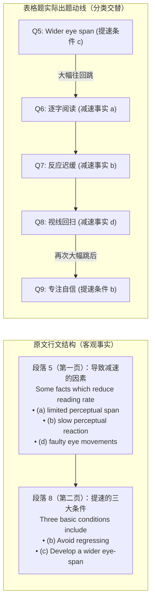

# 📖 雅思阅读真经 5 · 专项刷题与实战错题复盘本

> 💡 **复盘本使用与追加指南**：  
> 1. 本文档为《雅思阅读真经5》长期错题与同义替换沉淀库，后续每完成一篇练习，均以 `## 📄 篇目英文标题` 为分割线在文末向下追加。  
> 2. 核心复盘逻辑遵循刘洪波“真经派”解题法：**找路标 ➔ 定区间 ➔ 对同义 ➔ 析陷阱 ➔ 锁答案**。  
> 3. 重点记录“为什么错、卡在哪里、原文怎样同义改写”，坚决杜绝“只对答案不纠思维”。

---

## 📄 Passage 1: Improving Reading Speed（提高阅读速度 · P20-P23）

* 📅 **练习日期**：2026-11-02  
* 🎯 **本篇题型**：单项选择题（Q1-Q4）+ 表格填空题（Q5-Q9）+ 判断题（Q10-Q13）  
* ❌ **本次错题战报**：**错 Q5、Q6、Q7、Q8、Q9**（表格题全军覆没）  
* 📌 **核心错因复盘**：**受“顺序原则”思维定势误导，忽视了表格题特有的“按属性/表头分类跳跃”特征，在 Q5 定位到后半部分后，未意识到 Q6-Q9 需要“折返回原文前半段”寻找，导致连续定位全盘失守。**

---

### 🚨 深度错因剖析：为什么这篇表格题会“满盘皆输”？

#### 1. 致命陷阱：把表格题当成了“绝对顺序题”
在很多雅思细节填空题（如单段 Summary 填空）中，题目确实基本遵循从上往下的“行文顺序”。但**表格填空题（Table Completion）有着极其特殊的命题逻辑：它是按表格逻辑分类，而不是按文章行文线性出题的！**

#### 2. 本题的行文结构与题目“乾坤大挪移”对比：

#### 3. 破局关键：表格的“表头与打钩列”才是真正的导航罗盘！
看题时，绝不能只盯着左侧的题干文字，**必须先看表头和属性列**：
* 表格第 3 列：`Reduces rate`（降低速度）
* 表格第 4 列：`Increases rate`（提高速度）

| 题号 | 表格属性判定 | 原文对应专区 |
| :---: | :---: | :--- |
| **Q5** | `Increases rate: YES` | 必须去后半段【三大提速条件】里找 |
| **Q6** | `Reduces rate: YES` | **警报拉响！必须立刻回头，去前半段【导致减速的因素】里找！** |
| **Q7** | `Reduces rate: YES` | 紧随 Q6，在前半段【导致减速的因素】同区 |
| **Q8** | `Reduces rate: YES` | 紧随 Q7，在前半段【导致减速的因素】同区 |
| **Q9** | `Increases rate: YES` | **警报再次拉响！再次跳到后半段【三大提速条件】里找！** |

---

### 階 逐题阶梯解题思路与同义替换精解

---

#### 📂 Question 4: 单项选择题（程度加深同义替换）
* **题干**：  
  > `Speeding up your reading rate through forced acceleration often results in`  
  > A. reducing comprehension.  
  > B. increasing comprehension.  
  > **C. increasing your reading problem.**  
  > D. reducing your reading problem.

* **阶梯解题流程**：
  1. **抓特殊定位词**：`forced acceleration`（强行加速，罕见专业术语，全篇仅一处）。
  2. **顺藤摸瓜找原句**（PDF P21 第一行）：
     > “...simply speeding the rate, especially through **forced acceleration**, may actually result, and **often does**, in **making the real reading problem more severe**.”
  3. **同义替换锁定**：
     * `often results in` $\Longleftrightarrow$ `may actually result, and often does, in`
     * `increasing your reading problem` $\Longleftrightarrow$ `making the real reading problem more severe`（把“问题更严重”转换为“增加问题”，程度加深替换）。
  4. **避坑结论**：选项 A/B 文中未在此句讨论；选项 D（减轻问题）与原文方向相反。**稳锁 C**。

---

#### 📂 Question 5: 表格填空（提速条件 c · 动宾词块提取）
* **题干信息**：
  * `Factors`: `Wider eye span`
  * `Effects`: **(5) [填空]**
  * `Increases rate`: **YES**（路标：前往提速区）
  * 字数限制：不超过 3 个词（NO MORE THAN THREE WORDS）

* **阶梯解题流程**：
  1. **按路标进专区**：锁定 PDF P21【Three basic conditions include】提速条件。
  2. **锁定核心定位词**：条件 (c) 开头 `Develop a wider eye-span`，与题干完全重合。
  3. **精读原句查效果（Effects）**：
     > “(c) Develop a **wider eye-span**... Since written material is less meaningful if read word by word, this will help you **learn to read by phrases** or thought units.”
  4. **提炼答案词**：
     * 宽视幅带来的具体表现/效果是：帮助学会“按短语/意群阅读”。
     * 题干表格 Effect 栏需要动宾/名词性短语表达。
  5. **最终答案**：**`Reading phrases`** 或 **`Read by phrases`**。

---

#### 📂 Question 6: 表格填空（折返前半段 · i.e. 同位解释符号）
* **题干信息**：
  * `Factors`: **(6) [填空]**
  * `Effects`: `Word-by-word reading`
  * `Reduces rate`: **YES**（路标警报：必须折返到减速区！）

* **阶梯解题流程**：
  1. **破除线性思维，大跨度回跳**：看到 `Reduces rate: YES`，目光迅速移回 PDF P20【Some of the facts which reduce reading rate】段落。
  2. **用定位词扫射**：扫视 (a) 到 (f) 六个分项，瞬间抓到 `word-by-word reading`。
  3. **真经符号密码 —— `i.e.`（that is 即/也就是）**：
     > “(a) **limited perceptual span** i.e., **word-by-word reading**;”
     * `i.e.` 是雅思极高频的**同位解释路标**，`i.e.` 前面是抽象原因（Factor），后面是具体表现（Effect）。
  4. **最终答案**：原词无损移入 **`Limited perceptual span`**。

---

#### 📂 Question 7: 表格填空（顺延减速区 · 严格字数精简）
* **题干信息**：
  * `Factors`: `Slow perceptual reaction`
  * `Effects`: **(7) [填空]**
  * `Reduces rate`: **YES**

* **阶梯解题流程**：
  1. **顺着减速区往下看**：紧随 (a) 的下一条就是 (b) 项。
  2. **核对原句**：
     > “(b) **slow perceptual reaction** time, i.e., **slowness of recognition** and response to the material;”
  3. **字数陷阱破局**：
     * `i.e.` 后面引出的整段是 `slowness of recognition and response to the material`，共 8 个单词！
     * 题目字数上限是 **不超过 3 个词**。
     * 抓取最前面的核心修饰词块：`slowness of recognition`（正好 3 个词）。
  4. **最终答案**：**`Slowness of recognition`**。

---

#### 📂 Question 8: 表格填空（结构倒装替换 · 概括性总称抓取）
* **题干信息**：
  * `Factors`: **(8) [填空]**
  * `Effects`: `Return sweep inaccuracy`
  * `Reduces rate`: **YES**

* **阶梯解题流程**：
  1. **定位词扫描**：在减速区继续向下找 `return sweep`，在 (d) 项抓到。
  2. **核对原句**：
     > “(d) **faulty eye movements**, including **inaccuracy** in placement of the page, **in return sweep**, in rhythm and regularity of movement, etc.;”
  3. **真经语法倒装识别**：
     * 原文：`inaccuracy ... in return sweep`（介词短语后置修饰）
     * 题干：`Return sweep inaccuracy`（名词作定语前置修饰）
     * 两者 100% 同义！
  4. **逻辑层级锁定**：
     * 原文用了 `including...`，说明后面的 inaccuracy 只是具体举例表现。
     * 前面的总括性原因（Factor）是 **`faulty eye movements`**。
  5. **最终答案**：**`Faulty eye movements`**。

---

#### 📂 Question 9: 表格填空（二次折返提速区 · 正反互推逻辑）
* **题干信息**：
  * `Factors`: **(9) [填空]**
  * `Effects`: `Concentrate and be confident`
  * `Increases rate`: **YES**（路标警报：属性反转，再次跳至后半段提速区！）

* **阶梯解题流程**：
  1. **跨段折返**：跳回 PDF P21【三大提速条件】。
  2. **正反同义逻辑推导（Antonym Paraphrase）**：
     * 题干正面表现是：`Concentrate and be confident`（专注且充满自信）。
     * 原文条件 (b) 中写道：
       > “(b) **Avoid regressing** (rereading)... his rereading reflects both **his inability to concentrate** and **his lack of confidence** in his comprehension skills.”
     * 原文说回读（rereading）会导致“无法专注（inability to concentrate）”和“缺乏自信（lack of confidence）”。
     * **逆向思考**：要达成“能专注且有自信”，必须采取的提速做法就是该条的核心命令句：**`Avoid regressing`**！
  3. **最终答案**：**`Avoid regressing`**。

---

### 📝 真经派·本篇高价值考点词与同义替换对照总表

| 序号 | 题干 / 题目表达 | 原文出处表达 | 考点逻辑模式 |
| :---: | :--- | :--- | :--- |
| **1** | `increase reading problem` | `make reading problem more severe` | 程度加深同义替换 |
| **2** | `often results in` | `may actually result, and often does, in` | 因果信号词精准重合 |
| **3** | `Factors` $\rightarrow$ `Effects` | 原文中的 `i.e.` (即) / `including` (包括) | 标点符号与列举词的逻辑功能 |
| **4** | `return sweep inaccuracy` | `inaccuracy ... in return sweep` | 定语位置前后置结构倒装 |
| **5** | `concentrate and be confident` | 反向避免 `inability to concentrate & lack of confidence` | 正反逆向推理（Antonym Paraphrase） |

---

### 🛡️ 未来做“表格填空题”的 3 大终极军规

1. **表头先于题干**：拿到表格题，第一时间把每一列的表头划出来（特别注意：`Positive/Negative`、`Increases/Reduces`、`Advantages/Disadvantages` 等分类列）。
2. **警惕跳跃乱序**：表格题**以“行”为单位，其分类属性决定了它在原文的所属段落**。如果上一题是“优点/提速”，下一题突然变成了“缺点/减速”，必须立刻反应过来：**要回跳到前文的缺点段落！**
3. **善用标点符号解密**：原文中出现的 `i.e.`（即）、`e.g.`（例如）、破折号 `--`、冒号 `:` 以及 `including`，是表格题最喜欢的“大概念 $\leftrightarrow$ 具体表现”出题点。
